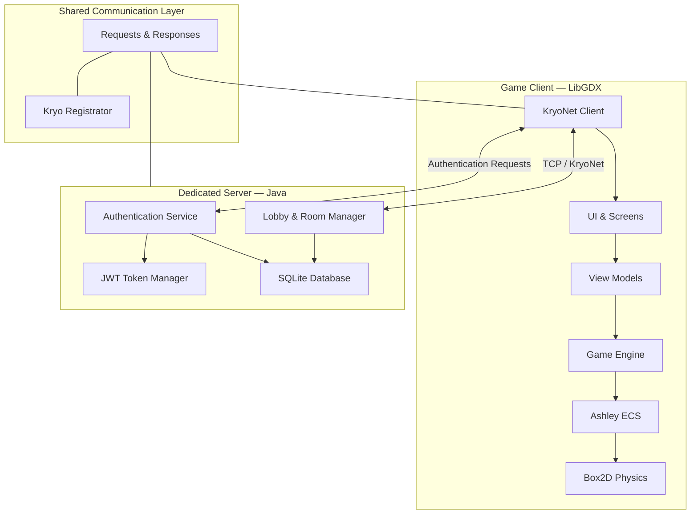

# Stardew Valley — Multiplayer Farming & Life Simulation

<p align="center">
  
  
  
  
  
</p>

<p align="center">
  <strong>A feature-rich 2D farming and life simulation game, built from the ground up with Java and LibGDX.</strong>
</p>

---

## About the Project

Stardew Valley is a 2D farming and life simulation game developed in Java using the LibGDX framework. Inspired by the farming simulation genre, the project brings together a rich set of gameplay mechanics, an entity-component-based game architecture, physics simulation, and a networked client-server infrastructure.

The game features an interactive world where players can cultivate crops, raise farm animals, explore mines, fish, craft items, cook meals, manage resources, and develop their farming and other abilities.

Beyond gameplay, the project incorporates a dedicated server application, account management, authentication, and multiplayer lobby and room management. Its architecture combines game development techniques with practical software engineering concepts, making it a substantial exploration of both interactive systems and networked applications.

## ✨ Features

### 🌱 Farming & World Simulation

- **Crop Cultivation:** Plant seeds, water crops, and harvest products through a multi-stage crop growth system.
- **Seasonal Gameplay:** Four seasons — Spring, Summer, Fall, and Winter — with season-dependent crops and weather.
- **Dynamic Weather:** Sunny, rainy, stormy, and snowy conditions with corresponding environmental effects.
- **Crop Growth Simulation:** Time-dependent growth, regrowth, watering mechanics, and giant crop generation.
- **Resource Generation:** Procedurally placed environmental resources, including trees, stones, grass, and wood.
- **Interactive Environments:** Multiple explorable maps with object interactions, collision handling, and transitions.

### 🐄 Animal Husbandry

- Raise and manage different types of farm animals.
- Build and use barns and coops with different capacity tiers.
- Feed and interact with animals to improve their friendship.
- Collect animal products such as milk, eggs, wool, and other resources.
- Manage animal health, daily interactions, and production.

### ⛏️ Exploration & Mining

- Explore dedicated mine environments.
- Break mineral nodes and collect valuable resources.
- Discover different minerals, ores, and gemstones.
- Use specialized tools for mining, gathering, and resource collection.

### 🎣 Fishing

- Interactive fishing mini-game built with Box2D physics.
- Multiple fish types with different seasonal availability.
- Different fish movement patterns and difficulty levels.
- Fishing skill progression and valuable catches.

### 🛠️ Crafting, Cooking & Economy

- Craft items using resource-based recipes.
- Prepare meals through an interactive cooking system.
- Purchase supplies, animals, buildings, and other products from in-game shops.
- Manage inventory, item stacks, storage capacity, and equipment.
- Earn and manage gold through the game's economic systems.

### 📈 Player Progression

- Four skill categories: Farming, Mining, Foraging, and Fishing.
- Experience points and level progression.
- Energy management and tool-dependent energy consumption.
- Player profile, statistics, and customizable avatar.
- In-game journal, map, inventory, and skill interfaces.

### 🌐 Online Infrastructure

- Dedicated Java server application.
- TCP-based client-server communication using KryoNet.
- User registration and authentication.
- JWT-based session tokens with configurable session lifetimes.
- Public and password-protected game rooms.
- Room discovery and multiplayer lobby.
- Room membership management with a maximum capacity of four players.
- Host-based game-start coordination.
- Persistent user accounts and profile information using SQLite.

---

## 🏗️ Architecture

The project is organized around a modular client-server architecture, separating the graphical game client, server-side services, and shared communication models.

### High-Level Architecture



### Client Architecture

The client is built on LibGDX and uses Ashley's Entity Component System (ECS) to organize game entities and gameplay behavior.

Instead of implementing every game object as a large monolithic class, the game uses reusable components and specialized systems.

**Core architectural elements:**

| Component | Responsibility |
|---|---|
| `GdxGame` | Main application lifecycle, shared resources, and screen management |
| `GameScreen` | Main gameplay orchestration |
| `MapManager` | Map loading, caching, and transitions |
| `AssetService` | Centralized asset loading and management |
| `AudioService` | Music and sound playback |
| `Engine` | Ashley entity and system management |
| `TiledService` | Tiled map loading and configuration |
| `TransitionManager` | Animated screen and map transitions |

### Entity Component System

The game uses Ashley ECS to separate entity data from behavior.

**Components** represent individual aspects of an entity, including:

- `Transform` — position and spatial information.
- `Physic` — Box2D body and physics state.
- `Graphic` — rendering information.
- `Animation2D` — animation configuration.
- `Controller` — entity interaction and control.
- `Growable` — crop and growth-related state.
- `ItemHolder` — items associated with entities.
- `Player` — player-specific data.

**Systems** process entities and implement gameplay behavior:

- `RenderSystem`
- `PhysicSystem`
- `PhysicMoveSystem`
- `AnimationSystem`
- `ControllerSystem`
- `GrowSystem`
- `WeatherSystem`
- `FarmAnimalSystem`
- `CollectingSystem`
- `FishingSystem`
- `EnergySystem`
- `CameraSystem`
- `CrowAttackSystem`
- `SeasonalGraphicSystem`

This separation makes gameplay behavior more modular and allows different maps to configure their own system collections.

### Map Architecture

The world is divided into specialized map implementations built on top of a common `MapAdaptor` abstraction.

| Map | Purpose |
|---|---|
| Farm | Farming, gathering, and outdoor activities |
| House | Indoor environments and farm buildings |
| Mine | Mining and resource exploration |
| Store | Shops and purchasing interactions |

Maps are loaded through Tiled, configured with game entities and physics bodies, and managed through `MapManager`.

The map system also supports caching, allowing previously initialized environments to be reused during gameplay.

### UI Architecture

The user interface follows a View / ViewModel-oriented organization.

Views are responsible for presentation, while their corresponding ViewModels handle application-facing logic and interactions.

The game includes dedicated screens for:

- Main Menu
- Login
- Signup
- Profile
- Lobby
- Joining Room
- Pre-Game
- Gameplay

Scene2D is used for interactive UI elements, menus, dialogs, widgets, and input handling.

---

## 🌐 Client-Server Architecture

The online infrastructure is implemented using KryoNet and a shared communication layer.

### Communication Protocol

Both client and server register the same request and response classes through `Registrator`.

This provides a consistent serialization protocol and allows both sides to exchange strongly typed Java objects.

The communication layer is organized into:

```text
global/
├── requests/
├── responses/
├── model/
├── utils/
├── Configuration.java
└── Registrator.java
```

### Authentication

The server handles account-related operations, including:

- User registration and login.
- Credential validation.
- Password recovery using security questions.
- Profile information retrieval.
- Username, nickname, email, and avatar updates.
- Password changes.

JWT tokens are issued after successful authentication and used to identify authenticated sessions.

### Lobby & Room Management

The server maintains active player connections and game rooms.

Players can:

1. Browse available public rooms.
2. Create a new room.
3. Set a room password.
4. Join an existing room.
5. View other players in the room.
6. Start the game as the room owner.

Rooms support up to four players, with the server coordinating room membership and host-based start-game notifications.

**Note:** The inspected implementation establishes the account, lobby, room-management, and game-start coordination infrastructure. It should not be interpreted as proof of fully synchronized in-world multiplayer gameplay.

---

## 🧰 Technology Stack

| Technology | Usage |
|---|---|
| Java 17 | Core programming language |
| LibGDX 1.13.1 | Game development framework |
| LWJGL3 | Desktop backend |
| Ashley | Entity Component System |
| Box2D | Physics simulation |
| KryoNet | Client-server networking |
| Kryo | Object serialization |
| SQLite | Persistent account storage |
| Java JWT | Authentication and session tokens |
| Tiled | Tile-based map design and loading |
| GDX AI | Game AI utilities |
| Gradle | Build automation and dependency management |

---

## 🚀 Getting Started

### Prerequisites

- Java Development Kit (JDK) 17
- Git
- Internet connection for downloading dependencies

### Clone the Repository

```bash
git clone https://github.com/ParsaSabzei/Stardew-Valley.git
cd Stardew-Valley
```

### Run the Game Client

On Linux and macOS:

```bash
chmod +x gradlew
./gradlew lwjgl3:run
```

On Windows:

```powershell
gradlew.bat lwjgl3:run
```

### Run the Server

The server entry point is:

```text
com.ap.server.Server
```

Run this main class from your IDE using the project's Gradle classpath.

The server initializes the SQLite database, registers network message types, starts the KryoNet server, and listens for client connections.

### Network Configuration

The default network configuration is defined in:

```text
com.ap.global.Configuration
```

| Setting | Default |
|---|---|
| Host | `localhost` |
| TCP Port | `54555` |
| UDP Port | `54777` |
| Response Timeout | `5000 ms` |

For remote connections, configure the client host address to point to the server machine.

---

## 📂 Source Code Organization

The main implementation is located in:

```text
core/src/main/java/com/ap/
│
├── client/
│   ├── asset/          # Asset loading and resource management
│   ├── audio/          # Audio services
│   ├── component/      # ECS components
│   ├── input/          # Keyboard and UI input handling
│   ├── items/          # Items, tools, crops, animals, inventory
│   ├── managers/       # Gameplay managers
│   ├── model/          # Gameplay data and enumerations
│   ├── network/        # Client networking and listeners
│   ├── screen/         # Game screens and map implementations
│   ├── state/          # Animation states
│   ├── system/         # Ashley ECS systems
│   ├── tiled/          # Tiled map integration
│   ├── ui/             # Views, ViewModels, widgets, effects
│   └── utils/          # Client utilities
│
├── server/
│   ├── database/       # SQLite connection and user persistence
│   ├── listeners/      # Authentication and lobby listeners
│   ├── model/          # Server players and rooms
│   ├── utils/          # JWT token management
│   ├── GameServer.java
│   └── Server.java
│
└── global/
    ├── model/          # Shared data models
    ├── requests/       # Client-to-server messages
    ├── responses/      # Server-to-client messages
    ├── utils/          # Shared validation and cryptography
    ├── Configuration.java
    └── Registrator.java
```

---

## 👥 Contributors

Developed as a collaborative software engineering and game development project.

- **Parsa Sabzei** — [GitHub](https://github.com/ParsaSabzei)

See the repository's contributor history for additional contributors.

---

## 🎮 Inspiration

Inspired by [Stardew Valley](https://www.stardewvalley.net/), the farming and life simulation game developed by ConcernedApe.

This project is an independent implementation for educational and software engineering purposes and is not affiliated with or endorsed by ConcernedApe.

---

<p align="center">
  <strong>Built with Java, LibGDX, and a love for game development.</strong>
</p>
